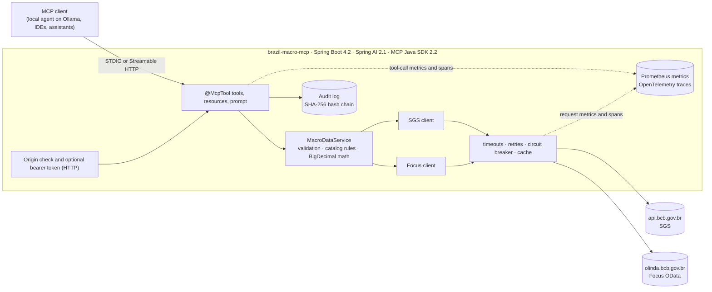

# brazil-macro-mcp

[](https://github.com/gharachide/brazil-macro-mcp/actions/workflows/ci.yml)
[](https://github.com/gharachide/brazil-macro-mcp/actions/workflows/bcb-contract.yml)


An [MCP](https://modelcontextprotocol.io) server that gives AI agents **cited, verifiable access to
Banco Central do Brasil data**, and refuses to guess.

Ask an assistant "what was the real return of the CDI over the last 12 months?" and it will often
answer from memory, mix up % per month and % per year, or compound the numbers wrong. With this
server the agent gets the official figures, computed by the server, with the exact URL each number
came from. When the question cannot be answered correctly, the agent gets an explicit error
instead of a plausible number.

The server never calls a language model, so it is vendor-neutral: any MCP client can use it. The
repository includes an agent that runs on a **local open model in Ollama**, so the whole setup can
run on your machine.

*Resumo em português no [fim da página](#resumo-em-português).*

## What it does

- **Every number is cited.** Results carry the BCB API URLs that produced them, when they were
  retrieved, and a ready-to-quote `citeAs` string.
- **The server does the math.** Compounding and real returns are computed in exact decimal
  arithmetic (34 significant digits), not by the language model.
- **It fails closed.** Six error codes, each with guidance. The guidance always ends the same way:
  do not estimate, interpolate or recall values from memory.
- **It knows the data's traps.** Units and meaning of each series are part of the catalog, so the
  server refuses to compound an annual rate or a 12-month figure, never compounds a month that is
  still in progress, and explains future-dated Selic target values.
- **It is auditable.** Every tool call is appended to a SHA-256 hash-chained log that can be
  verified offline.
- **It is production-shaped.** Timeouts, retries with backoff and jitter, a circuit breaker per
  BCB host, an in-memory cache with a flagged stale fallback, Prometheus metrics, OpenTelemetry
  traces and structured logs.
- **It is evaluated.** The example agent ships with an eval suite that grades a local model's
  answers against the numbers the tools actually returned.

## Tools

| Tool | Answers | Example arguments |
|---|---|---|
| `list_series` | Which series exist, their units and caveats | none |
| `get_series` | Official observations between two dates, with a summary | `IPCA`, `2025-01-01`, `2025-12-31` |
| `get_latest` | The most recent final values | `SELIC_TARGET` |
| `accumulated_change` | Compounded change over whole months | `IPCA`, `2025-01`, `2025-12` |
| `real_return` | Inflation-adjusted return (Fisher relation) | `CDI_MONTHLY`, `IPCA`, `2025-11`, `2026-10` |
| `market_expectations` | Focus survey median, mean, spread, respondents | `IPCA`, `2027` |

All tools are annotated read-only and idempotent. The server also exposes two **resources**
(`brazil-macro://catalog` and `brazil-macro://methodology`) and one **prompt**
(`macro_briefing`) that drives a cited briefing on monetary conditions.

**Series:** IPCA, IPCA_12M, INPC, IGPM, SELIC_TARGET, SELIC_MONTHLY, SELIC_ANNUALIZED, CDI_MONTHLY,
USD_BRL (SGS codes 433, 13522, 188, 189, 432, 4390, 4189, 4391 and 1).
**Focus indicators:** IPCA, SELIC, PIB_TOTAL, CAMBIO, IGPM.

## Example

Real output against the live API on 2026-11-24, shortened. The question was "what was the real
return of the CDI over the last 12 months?":

```json
{
  "startMonth": "2025-11",
  "endMonth": "2026-10",
  "months": 12,
  "nominal":   { "series": { "alias": "CDI_MONTHLY", "sgsCode": 4391 }, "accumulatedPercent": 14.2315 },
  "inflation": { "series": { "alias": "IPCA", "sgsCode": 433 },         "accumulatedPercent": 4.6284 },
  "realReturnPercent": 9.1783,
  "method": "Fisher relation: (1 + nominal) / (1 + inflation) - 1, from the compounded factors of both series over the same months.",
  "citations": [
    {
      "seriesCode": 4391,
      "requests": [
        {
          "url": "https://api.bcb.gov.br/dados/serie/bcdata.sgs.4391/dados?formato=json&dataInicial=01/11/2025&dataFinal=31/10/2026",
          "retrievedAt": "2026-11-24T10:35:28Z",
          "cache": "MISS"
        }
      ],
      "stale": false,
      "citeAs": "Banco Central do Brasil, SGS series 4391 (Taxa de juros - CDI acumulada no mês), retrieved 2026-11-24T10:35:28Z: https://www3.bcb.gov.br/sgspub/..."
    }
  ]
}
```

Asking for the same calculation up to November 2026, a month still in progress on that date:

```json
{
  "error": {
    "code": "INVALID_ARGUMENT",
    "message": "endMonth (2026-11) is still in progress, so its value is not final. The latest month that can be compounded is 2026-10.",
    "retryable": false,
    "guidance": "Fix the arguments and call the tool again. Do not estimate, interpolate or recall values from memory to replace the missing data."
  }
}
```

Errors are returned as tool results with `isError: true`, so the agent can read them and react,
and every payload is sent both as JSON text and as `structuredContent`.

## Things the live API taught us

The test suite includes a contract test against the real BCB APIs (run weekly in CI). Running it
changed the design in three places:

1. **The month in progress.** The SGS publishes the Selic and CDI "accumulated in the month" for
   the current month as a running total. Compounding it as if it were final silently understates the
   result. Such values are now flagged `partial`, left out of `get_latest`, and rejected by
   `accumulated_change` and `real_return`.
2. **HTTP 304 to plain requests.** Some SGS URLs answer `304 Not Modified` to requests that are not
   conditional. The client retries those once with the API's own `nocache=true` parameter.
3. **Future-dated Selic target.** Series 432 is published for every calendar day until the next
   Copom meeting, so a naive "last value" is a date in the future. `get_latest` only returns values
   dated up to today in Brasília, and `get_series` explains the future dates.

Other rules come from the API documentation: daily series accept at most 10 years per request
(validated before calling), `ultimos/N` accepts at most 20 values, and monthly values are dated on
the first day of the month.

## Architecture



| Package | Responsibility |
|---|---|
| `catalog` | The closed list of series, their units and which calculations are valid |
| `upstream` | HTTP clients, resilience, cache and strict payload parsing |
| `service` | Argument validation, windowing, compounding, citations |
| `tools` | MCP tools, resources and prompt; turns results and errors into MCP results |
| `audit` | Hash-chained log, verifier and `--verify-audit` command |
| `web` | HTTP endpoint protection and health indicator |

## Quick start

Requires Java 21. The Maven wrapper downloads Maven and checks its SHA-256.

```bash
./mvnw verify   # builds the jar and runs the test suite
```

### Run it locally with an open model

`examples/ollama-agent` is a small Spring AI command-line agent. It uses a local open model in
[Ollama](https://ollama.com) and launches this server over STDIO. Prompts stay on your machine;
the only outbound requests are the server's calls to the BCB API.

```bash
ollama pull gemma4:e2b          # Ollama 0.20.2 or newer
./mvnw package                  # builds target/brazil-macro-mcp.jar
cd examples/ollama-agent
../../mvnw package
java -jar target/ollama-agent.jar "Qual foi o retorno real do CDI nos últimos 12 meses?"
```

Pick another model with `--spring.ai.ollama.chat.model=<name>`. Any model tagged `tools` in the
Ollama library works. Sizes below are the Ollama downloads at the time of writing; leave some
memory free for the context.

| GPU memory | Model | Download | Notes |
|---|---|---|---|
| 6 GB | `gemma4:e2b` (default), `qwen3:4b` | 4.6–7.5 GB, ~2.4 GB | Fast; enough for one or two tool calls per question |
| 6–8 GB | `gemma4:e4b` | 6.6–9.5 GB | Better reasoning; on a 6 GB card part of it runs on the CPU |
| 8 GB | `qwen3:8b` | 5.2 GB | Fits with a 16k context |
| 12–16 GB | `gemma4:12b` | 7.7–8.0 GB | Room for long contexts |
| 24 GB | `gemma4:26b` (MoE), `qwen3:30b` (MoE) | 16–19 GB, ~18 GB | Fast for their size: few active parameters |
| 24 GB | `gemma4:31b` | 19–20 GB | Best quality of the family, slowest |

`ollama ps` shows whether the model runs fully on the GPU. Answer quality depends on the model: a
small model may choose wrong arguments, and the server then returns an error instead of a number. The example's test replaces Ollama with a scripted stand-in, so CI checks the whole
tool-calling loop, including tool errors reaching the model, without a GPU.

### Evaluate a local model

The agent includes an eval suite (`src/main/resources/eval/cases.json`): 21 questions in
Portuguese: 18 that cover every tool and 3 traps whose right answer is to decline
(a month that has not happened, a Focus horizon nobody projects, a series the server does not have). For the future month, answering with the Focus projection, clearly labelled as one, also counts. Run it
against one or more pulled models:

```bash
cd examples/ollama-agent
java -jar target/ollama-agent.jar --eval --models=gemma4:e2b,gemma4:e4b --runs=3
```

Each answer gets deterministic checks, with no judge model:

| Check | Passes when |
|---|---|
| Tool | The model called the expected tool |
| Args | That call carried the expected arguments (series, months, year) |
| Grounded | Every decimal number in the answer appears in a tool result, allowing for rounding. This catches invented values and the model doing its own arithmetic |
| Cited | The answer names its source (SGS, Focus, BCB) |
| Abstained | Trap questions only: the model got a tool error, gave no figure, or (for the future month) answered with the Focus projection, labelled as one |

The run writes `target/eval/eval-<timestamp>.md` (pass rates per check, p50/p95 latency, the
transcript of every failure) and a `.json` with all transcripts. Other options: `--cases=id,id`,
`--cases-file=my-cases.json`, `--out=dir`, and `--min-pass-rate=0.8`, which exits with status 1
below that rate. Questions use relative years (`{LAST_YEAR}`, `{NEXT_YEAR}`), so the suite stays
valid over time; the answers come from the live BCB API, so scores can move a little when the
data is revised. The first case of each model includes the time Ollama takes to load it.

#### Results: two sizes of Gemma 4 (2026-11-24)

21 questions × 3 runs per model against the live BCB API, temperature 0. Parameter counts are
Google's "effective" parameters for these models.

| Check | `gemma4:e2b` (2.3B effective) | `gemma4:e4b` (4.5B effective) |
|---|---|---|
| Tool | 97% | 100% |
| Args | 97% | 100% |
| Grounded | 100% | 100% |
| Cited | 98% | 100% |
| Abstained on traps | 100% | 100%\* |
| **Pass** | **95%** (60/63) | **100%\*** (63/63) |
| Median latency | 11.2 s | 13.7 s |
| p95 latency | 25.4 s | 31.0 s |

No invented numbers in any of the 126 answers. The smaller model's three misses: twice it
answered "how much did the CDI yield last month" with `real_return` (the inflation-adjusted
figure), and once it gave a correct figure without naming the source.

\* After one grading rule was fixed. Asked for December 2030's IPCA, `gemma4:e4b` said the month
had not happened yet and gave the Focus projection for 2030, clearly labelled as a projection,
with its source. The suite originally accepted only a refusal; before the fix these two rows
read 67% and 95%. Latency was measured on a laptop and depends on your hardware.

### Any other MCP client

Over STDIO, clients start the server with:

```text
command: java
args:    -jar /absolute/path/to/target/brazil-macro-mcp.jar --spring.profiles.active=stdio
```

Many clients read this from an `mcpServers` JSON block:

```json
{
  "mcpServers": {
    "brazil-macro": {
      "command": "java",
      "args": ["-jar", "/absolute/path/to/target/brazil-macro-mcp.jar", "--spring.profiles.active=stdio"]
    }
  }
}
```

Over Streamable HTTP, start `java -jar target/brazil-macro-mcp.jar` and point the client at
`http://127.0.0.1:8080/mcp`.

### From Python

MCP is a protocol, so the client does not need to be in Java. `examples/python-client` calls this
server with the official MCP Python SDK: it starts the jar over STDIO, lists the tools and asks for
the latest Selic target and 12-month IPCA, each with its citation.

```bash
cd examples/python-client
pip install -r requirements.txt
python client.py ../../target/brazil-macro-mcp.jar
```

### Docker

```bash
docker build -t brazil-macro-mcp .
docker run --rm -p 8080:8080 -v brazil-macro-audit:/home/mcp/.brazil-macro-mcp brazil-macro-mcp
# or, for a desktop client over STDIO:
docker run -i --rm brazil-macro-mcp --spring.profiles.active=stdio
```

## Configuration

Any property can be set as an environment variable (`BRAZIL_MACRO_HTTP_BEARER_TOKEN`, for example).

| Property | Default | Purpose |
|---|---|---|
| `brazil-macro.upstream.request-timeout` | `15s` | Timeout of one HTTP exchange with the BCB |
| `brazil-macro.upstream.max-attempts` | `3` | Attempts per request (network errors, 429, 5xx) |
| `brazil-macro.upstream.circuit-failure-threshold` | `5` | Failed requests in a row that open the circuit |
| `brazil-macro.cache.ttl` | `10m` | How long a response is served from memory |
| `brazil-macro.cache.max-stale` | `24h` | Oldest copy served, flagged stale, while the BCB is down |
| `brazil-macro.audit.path` | `~/.brazil-macro-mcp/audit.jsonl` | Audit log file |
| `brazil-macro.audit.fail-closed` | `false` | Refuse to answer when the audit record cannot be written |
| `brazil-macro.http.allowed-origins` | none | Browser origins allowed to call `/mcp` |
| `brazil-macro.http.bearer-token` | none | Require `Authorization: Bearer <token>` on `/mcp` |
| `server.address` | `127.0.0.1` | HTTP bind address (`0.0.0.0` in the container image) |

Verify an audit log at any time:

```bash
java -jar target/brazil-macro-mcp.jar --verify-audit ~/.brazil-macro-mcp/audit.jsonl
# OK: 5 entries, hash chain intact. Last hash: dfaed588...
```

## Observability

| Signal | Where | What |
|---|---|---|
| Metrics | `GET /actuator/prometheus` (HTTP mode) | See the table below; latency histograms for tool calls and BCB requests |
| Traces | OTLP, when `MANAGEMENT_OPENTELEMETRY_TRACING_EXPORT_OTLP_ENDPOINT` is set (e.g. `http://localhost:4318/v1/traces`) | A span per tool call with a child span per BCB request (URL, attempts, HTTP status) |
| Logs | stderr; `--spring.profiles.active=json-logs` switches to ECS JSON | stdout stays reserved for the MCP protocol in STDIO mode |
| Audit | `~/.brazil-macro-mcp/audit.jsonl` | Each record carries the `traceId` of its tool call, linking the audit trail to the trace |
| Health | `GET /actuator/health` | Circuit state per BCB host |

| Metric | Tags | Meaning |
|---|---|---|
| `brazil_macro_tool_calls_seconds` | `tool`, `outcome` (`ok` or an error code) | Calls and latency per tool |
| `brazil_macro_upstream_requests_seconds` | `upstream` (`sgs`, `focus`), `outcome` | BCB requests: `ok`, `not_found`, `rejected`, `not_modified`, `malformed`, `circuit_open`, `unavailable` |
| `brazil_macro_upstream_retries_total` | `upstream` | Retries after network errors, 429 or 5xx |
| `brazil_macro_upstream_circuit_state` | `upstream` | 0 closed, 1 open, 2 half-open |
| `brazil_macro_cache_lookups_total` | `upstream`, `result` (`hit`, `miss`, `stale_fallback`) | Cache efficiency, and how often stale data was served |

Tags stay low-cardinality: URLs and series codes go on spans, not on metrics. Useful alerts are a
non-zero circuit state, a rising `stale_fallback` rate, and the share of `outcome!="ok"` tool calls.

## Tests

| Layer | What it covers |
|---|---|
| Unit | Decimal math (IPCA 2023 compounds to 4.62%, the official figure), catalog rules, circuit breaker, audit chain tampering |
| Upstream | Real clients against an in-process fake BCB (JDK `HttpServer`): retries, timeouts, 304 handling, malformed payloads, cache and stale fallback |
| Protocol | The Spring Boot server over Streamable HTTP with the MCP Java SDK client: tools, schemas, errors, resources, prompt, audit, Origin check |
| Black box | The packaged jar launched over STDIO, as desktop MCP clients launch it; any stray byte on stdout fails it |
| Example agent | `examples/ollama-agent` with the real server jar and a scripted Ollama: tool calls, cited results and tool errors reach the model; the eval grader and report |
| Live contract | The real BCB APIs (`BCB_LIVE=true ./mvnw verify`), weekly in CI |

## Limitations

- The catalog is small on purpose: a series is added only once its unit and meaning are encoded.
- Compounding published monthly rates (two decimals) can differ by about 0.01 percentage point
  from official annual figures computed from index numbers.
- HTTP mode supports a static bearer token. Multi-user deployments need an OAuth 2.1 gateway.
- Data is provided for information only. This is not investment advice.

## Resumo em português

Servidor MCP em Java 21 (Spring Boot 4.2, Spring AI 2.1) que dá a agentes de IA acesso aos dados
do Banco Central (séries do SGS e expectativas do Focus) com **citação em cada número** e
**recusa explícita** quando a pergunta não pode ser respondida corretamente. A capitalização de
taxas e o retorno real são calculados pelo servidor, em aritmética decimal exata. O servidor
recusa operações inválidas (capitalizar taxa anual ou acumulado em 12 meses, ou um mês ainda em
andamento) e registra cada chamada num log com cadeia de hashes SHA-256. Funciona via STDIO
e Streamable HTTP com qualquer cliente MCP, e o repositório traz um agente que roda com modelo aberto local
(Ollama), com uma suíte de avaliação que mede se o modelo escolhe a ferramenta certa, cita a fonte
e não inventa números. Expõe métricas Prometheus, traces OpenTelemetry e logs JSON. A suíte de testes inclui o protocolo MCP
de ponta a ponta e um teste de contrato contra a API real do BCB, que revelou o caso do mês
corrente parcial no CDI e na Selic.

## License and data

Code under the [MIT License](LICENSE). Data from Banco Central do Brasil, published as open data
at [dadosabertos.bcb.gov.br](https://dadosabertos.bcb.gov.br) (most datasets under ODbL 1.0).
This project is not affiliated with the Banco Central do Brasil.
